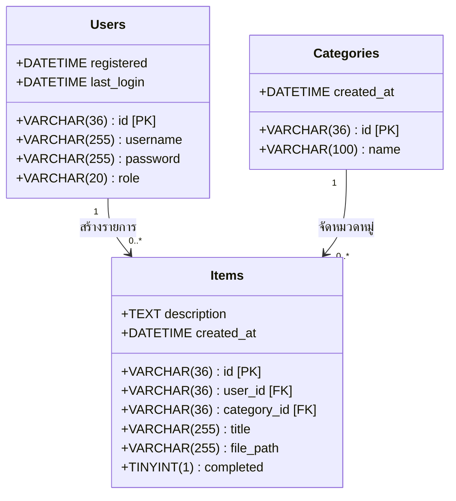
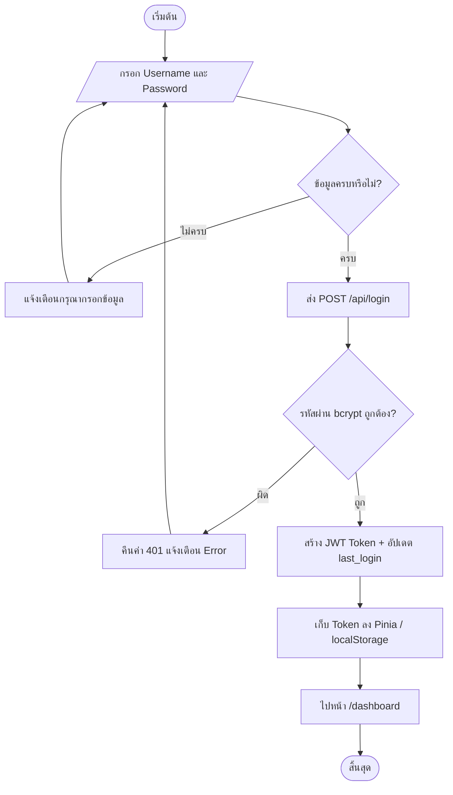

# คู่มือวิธีทำ Full-Stack Web Application ฉบับย่อจำง่าย (Vue 3 + Node.js + MySQL)

**สำหรับเตรียมความพร้อมการแข่งขันทักษะวิชาชีพ รายการที่ 58 (ส่วนที่ 4: ซอฟต์แวร์และการประยุกต์)**
*(อัปเดตตรงกับโค้ดเวอร์ชันปรับลดที่สั้นและจำง่ายขึ้น 40% ในโปรเจกต์ปัจจุบัน)*

---

## สูตรจำโครงสร้างทั้งโปรเจกต์ (สูตร 3-4-3)

จำแค่ 3 ก้อนนี้ก่อนลงมือเขียนโค้ด

- **Database 3 ตาราง** คือ `users`, `categories`, และ `items`
- **Backend 4 ไฟล์หลัก** คือ `lib/db.js`, `middleware/auth.js`, `routes/auth.js` (3 API), และ `routes/items.js` (5 API)
- **Frontend 3 หน้า + 3 ตัวช่วย** คือ `LoginView`, `RegisterView`, `DashboardView` คู่กับ `api.js`, `stores/auth.js`, และ `router/index.js`

```text
project-root/
├── .gitignore
├── README.md
├── database/
│   └── init.sql                 # SQL สร้าง DB และ 3 ตาราง
├── backend/
│   ├── lib/db.js                # ต่อ MySQL (mysql2/promise)
│   ├── middleware/auth.js       # ตรวจ JWT Token
│   ├── routes/auth.js           # register, login, profile
│   ├── routes/items.js          # categories + CRUD items + upload
│   ├── tests/
│   │   ├── unit.test.js         # Unit Test (Vitest)
│   │   └── integration.test.js  # Integration Test (Supertest)
│   ├── uploads/.gitkeep         # โฟลเดอร์เก็บไฟล์แนบ
│   ├── index.js                 # Express Server
│   ├── Dockerfile
│   ├── .dockerignore
│   └── package.json
└── frontend/
    ├── src/
    │   ├── api.js               # ตัวช่วยยิง API + แนบ Token อัตโนมัติ
    │   ├── assets/main.css      # CSS กลาง (Responsive)
    │   ├── stores/auth.js       # Pinia เก็บ Token และ User
    │   ├── router/index.js      # Route + Navigation Guard
    │   ├── views/
    │   │   ├── LoginView.vue
    │   │   ├── RegisterView.vue
    │   │   └── DashboardView.vue
    │   ├── App.vue
    │   └── main.js
    ├── tests/e2e.spec.js        # E2E Test (Playwright)
    └── package.json
```

---

## ขั้นตอนที่ 1: สร้างฐานข้อมูล MySQL 3 ตาราง (`node-jwt`)

สำหรับการสร้างฐานข้อมูล สามารถเลือกทำได้ 2 วิธีตามความถนัด:
- **วิธีที่ 1.1 (แนะนำสำหรับห้องสอบ ไม่ต้องจำโค้ด)**: คลิกสร้างผ่านหน้าจอ GUI ของโปรแกรม **DBeaver** ไม่ต้องกังวลเรื่องจำไวยากรณ์ SQL.
- **วิธีที่ 1.2 (แบบสคริปต์เร็ว 30 วินาที)**: รันผ่านคำสั่ง SQL Script ในหน้าต่าง SQL Editor ของ DBeaver.

---

### วิธีที่ 1.1: ใช้โปรแกรม DBeaver (คลิกสร้างผ่าน GUI ไม่ต้องจำโค้ด)

#### ขั้นเตรียมตัว: เชื่อมต่อ DBeaver กับ MySQL
1. เปิดโปรแกรม DBeaver คลิกเมนู `Database` > `New Database Connection` เลือก **MySQL**.
2. ช่อง **Host** ใส่ `localhost`, **Port** ใส่ `3306`, **Username** ใส่ `root`.
3. ช่อง **Password** ใส่รหัสผ่านของเครื่อง (เช่น `1234`) และติ๊ก `Save password`.
4. *(แก้ปัญหา Public Key Retrieval)*: คลิกแท็บ **Driver properties** ด้านบน เลื่อนหา `allowPublicKeyRetrieval` เปลี่ยนเป็น **`TRUE`** และ `useSSL` เปลี่ยนเป็น **`FALSE`**.
5. กดปุ่ม **Test Connection ...** ให้ขึ้นสีเขียวว่า `Connected` แล้วกด **Finish**.

#### ขั้นที่ 1: สร้างฐานข้อมูล (Database)
1. ที่แถบซ้ายมือ คลิกขวาที่หัวข้อ **Databases** > เลือก **Create New Database**.
2. ตั้งชื่อ Database Name: **`node-jwt`**.
3. เลือก Character Set: **`utf8mb4`** แล้วกด **OK**.

#### ขั้นที่ 2: สร้างตารางที่ 1 หมวดหมู่ (`categories`)
1. ดับเบิลคลิกเปิดฐานข้อมูล `node-jwt` > คลิกขวาที่โฟลเดอร์ **Tables** > เลือก **Create New Table** ตั้งชื่อ Table Name: `categories`.
2. คลิกขวาที่แท็บ Columns เลือก **Create New Column** เพิ่มทีละตัว:
   - **`id`**: Name ใส่ `id`, Type `INT`, ติ๊ก **Not Null**, ติ๊ก **Auto Increment**, กด **OK**
   - **`name`**: Name ใส่ `name`, Type `VARCHAR`, Length `100`, ติ๊ก **Not Null**, กด **OK**
   - **`description`**: Name ใส่ `description`, Type `TEXT`, ไม่ต้องติ๊ก Not Null (ปล่อย NULL), กด **OK**
3. **กำหนด Primary Key**: คลิกขวาที่คอลัมน์ `id` > เลือก **Create New Constraint** > เลือก **Primary Key** > กด **OK**
4. กดปุ่ม **Save (Ctrl + S)** > กดปุ่ม **Persist**

#### ขั้นที่ 3: สร้างตารางที่ 2 ผู้ใช้งาน (`users`)
1. คลิกขวาที่โฟลเดอร์ **Tables** > เลือก **Create New Table** ตั้งชื่อ Table Name: `users`.
2. คลิกขวาที่แท็บ Columns เลือก **Create New Column** เพิ่มทีละตัว:
   - **`id`**: Name ใส่ `id`, Type `VARCHAR`, Length `36`, ติ๊ก **Not Null**, กด **OK**
   - **`username`**: Name ใส่ `username`, Type `VARCHAR`, Length `255`, ติ๊ก **Not Null**, กด **OK**
   - **`password`**: Name ใส่ `password`, Type `VARCHAR`, Length `255`, ติ๊ก **Not Null**, กด **OK**
   - **`role`**: Name ใส่ `role`, Type `VARCHAR`, Length `20`, ติ๊ก **Not Null**, Default value ใส่ `'user1'`, กด **OK**
   - **`registered`**: Name ใส่ `registered`, Type `DATETIME`, ติ๊ก **Not Null**, Default value ใส่ `CURRENT_TIMESTAMP`, กด **OK**
   - **`last_login`**: Name ใส่ `last_login`, Type `DATETIME`, ไม่ต้องติ๊ก Not Null (ปล่อย NULL), กด **OK**
3. **กำหนด Primary Key**: คลิกขวาที่คอลัมน์ `id` > เลือก **Create New Constraint** > เลือก **Primary Key** > กด **OK**
4. กดปุ่ม **Save (Ctrl + S)** > กดปุ่ม **Persist**

#### ขั้นที่ 4: สร้างตารางที่ 3 รายการงาน (`items`)
1. คลิกขวาที่โฟลเดอร์ **Tables** > เลือก **Create New Table** ตั้งชื่อ Table Name: `items`.
2. คลิกขวาที่แท็บ Columns เลือก **Create New Column** เพิ่มทีละตัว:
   - **`id`**: Name ใส่ `id`, Type `VARCHAR`, Length `36`, ติ๊ก **Not Null**, กด **OK**
   - **`user_id`**: Name ใส่ `user_id`, Type `VARCHAR`, Length `36`, ติ๊ก **Not Null**, กด **OK**
   - **`category_id`**: Name ใส่ `category_id`, Type `INT`, ไม่ต้องติ๊ก Not Null, กด **OK**
   - **`title`**: Name ใส่ `title`, Type `VARCHAR`, Length `255`, ติ๊ก **Not Null**, กด **OK**
   - **`description`**: Name ใส่ `description`, Type `TEXT`, ปล่อย Length ว่าง, ไม่ต้องติ๊ก Not Null, กด **OK**
   - **`file_path`**: Name ใส่ `file_path`, Type `VARCHAR`, Length `255`, ไม่ต้องติ๊ก Not Null, กด **OK**
   - **`completed`**: Name ใส่ `completed`, Type `TINYINT`, Default value ใส่ `0`, กด **OK**
   - **`created_at`**: Name ใส่ `created_at`, Type `DATETIME`, Default value ใส่ `CURRENT_TIMESTAMP`, กด **OK**
3. **กำหนด Primary Key**: คลิกขวาที่คอลัมน์ `id` > เลือก **Create New Constraint** > เลือก **Primary Key** > กด **OK**
4. กดปุ่ม **Save (Ctrl + S)** > กดปุ่ม **Persist**

#### ขั้นที่ 5: เติมข้อมูลเริ่มต้นในตาราง categories (ไม่ต้องเขียน SQL)
1. ดับเบิลคลิกเปิดตาราง `categories` ที่แถบซ้ายมือ.
2. คลิกที่แท็บ **Data** ด้านบน.
3. มองที่แถบเครื่องมือด้านล่างตาราง กดปุ่มเครื่องหมายบวก **(+)** เพื่อเพิ่มแถวใหม่.
4. ดับเบิลคลิกพิมพ์ชื่อหมวดหมู่ในคอลัมน์ `name` เช่น:
   - แถวที่ 1: `เอกสารรายงาน`
   - แถวที่ 2: `สื่อการเรียนรู้`
   - แถวที่ 3: `ผลงานวิชาการ`
5. กดปุ่ม **Save (แผ่นดิสก์สีเขียวทางขวา หรือกด Ctrl + S)** เพื่อบันทึกข้อมูลเข้าฐานข้อมูล.

---

### วิธีที่ 1.2: ใช้คำสั่ง SQL Script (`database/init.sql`)

หากต้องการรันคำสั่ง SQL ทีเดียวจบใน 30 วินาที ให้กดคีย์ลัด `Ctrl + ]` ใน DBeaver แล้ววางคำสั่งด้านล่างนี้ จากนั้นกด `Alt + X` (Execute SQL Script):

```sql
CREATE DATABASE IF NOT EXISTS `node-jwt` CHARACTER SET utf8mb4 COLLATE utf8mb4_unicode_ci;
USE `node-jwt`;

-- 1. ตารางผู้ใช้งาน (รองรับสิทธิ์ 3 ระดับ: admin, user1, user2)
CREATE TABLE IF NOT EXISTS `users` (
  `id` VARCHAR(36) NOT NULL PRIMARY KEY,
  `username` VARCHAR(255) NOT NULL,
  `password` VARCHAR(255) NOT NULL,
  `role` VARCHAR(20) NOT NULL DEFAULT 'user1',
  `registered` DATETIME NOT NULL DEFAULT CURRENT_TIMESTAMP,
  `last_login` DATETIME NULL
);

-- 2. ตารางหมวดหมู่ (สำหรับทำตัวกรอง Filter และให้ครบ 3 ตาราง)
CREATE TABLE IF NOT EXISTS `categories` (
  `id` INT AUTO_INCREMENT NOT NULL PRIMARY KEY,
  `name` VARCHAR(100) NOT NULL,
  `description` TEXT NULL
);

INSERT IGNORE INTO `categories` (`name`, `description`) VALUES
('เอกสารรายงาน', 'ไฟล์เอกสารและรายงานประจำงวด'),
('สื่อการเรียนรู้', 'เอกสารประกอบการอบรมและสไลด์'),
('ผลงานวิชาการ', 'บทความและงานวิจัย');

-- 3. ตารางรายการข้อมูล (เชื่อม Foreign Key กับ users และ categories พร้อมไฟล์แนบ)
CREATE TABLE IF NOT EXISTS `items` (
  `id` VARCHAR(36) NOT NULL PRIMARY KEY,
  `user_id` VARCHAR(36) NOT NULL,
  `category_id` INT NULL,
  `title` VARCHAR(255) NOT NULL,
  `description` TEXT NULL,
  `file_path` VARCHAR(255) NULL,
  `completed` TINYINT(1) NOT NULL DEFAULT 0,
  `created_at` DATETIME NOT NULL DEFAULT CURRENT_TIMESTAMP,
  CONSTRAINT `fk_items_user` FOREIGN KEY (`user_id`) REFERENCES `users`(`id`) ON DELETE CASCADE,
  CONSTRAINT `fk_items_category` FOREIGN KEY (`category_id`) REFERENCES `categories`(`id`) ON DELETE SET NULL
);
```

---

## ขั้นตอนที่ 2: สร้างระบบ Back-end (`Node.js + Express`)

### 2.1 ติดตั้งแพ็กเกจและตั้งค่า `backend/package.json`

```bash
mkdir backend
cd backend
npm init -y
npm install express cors mysql2 bcrypt jsonwebtoken multer
npm install -D vitest supertest
```
*(ไม่ต้องลง `uuid` เพราะใช้ `crypto.randomUUID()` ที่มากับ Node.js อยู่แล้ว)*

เพิ่มคำสั่งใน `backend/package.json` ส่วน `"scripts"`:

```json
"scripts": {
  "start": "node index.js",
  "test": "vitest run"
}
```

### 2.2 สร้าง `backend/lib/db.js` (9 บรรทัด)

```js
const mysql = require('mysql2/promise');

const db = mysql.createPool({
  host: process.env.DB_HOST || 'localhost',
  user: process.env.DB_USER || 'root',
  password: process.env.DB_PASSWORD || '1234',
  database: process.env.DB_NAME || 'node-jwt'
});

// ตรวจสอบการเชื่อมต่อและแสดงข้อความแจ้งเตือนใน Terminal
db.getConnection()
  .then((conn) => {
    console.log('เชื่อมต่อฐานข้อมูล MySQL สำเร็จ!');
    conn.release();
  })
  .catch((err) => {
    console.error('เชื่อมต่อ MySQL ไม่สำเร็จ:', err.message);
  });

module.exports = db;
```

### 2.3 สร้าง `backend/middleware/auth.js` (16 บรรทัด)

```js
const jwt = require('jsonwebtoken');

const JWT_SECRET = process.env.JWT_SECRET || 'your-secret-key-change-in-production';

function verifyToken(req, res, next) {
  const token = req.headers.authorization?.split(' ')[1];
  if (!token) {
    return res.status(401).json({ status: 'error', message: 'กรุณาเข้าสู่ระบบ (ไม่พบ Token)', data: null });
  }
  try {
    req.user = jwt.verify(token, JWT_SECRET);
    next();
  } catch {
    res.status(403).json({ status: 'error', message: 'Token ไม่ถูกต้องหรือหมดอายุ', data: null });
  }
}

module.exports = { verifyToken, JWT_SECRET };
```

### 2.4 สร้าง `backend/routes/auth.js` (สมัครสมาชิก / เข้าสู่ระบบ / โปรไฟล์)

```js
const express = require('express');
const crypto = require('crypto');
const bcrypt = require('bcrypt');
const jwt = require('jsonwebtoken');
const db = require('../lib/db');
const { verifyToken, JWT_SECRET } = require('../middleware/auth');

const router = express.Router();

// สมัครสมาชิกใหม่
router.post('/register', async (req, res) => {
  const { username, password, role } = req.body;
  if (!username || !password) {
    return res.status(400).json({ status: 'error', message: 'กรุณากรอกชื่อผู้ใช้และรหัสผ่าน', data: null });
  }

  try {
    const [existing] = await db.query('SELECT id FROM users WHERE LOWER(username) = LOWER(?)', [username]);
    if (existing.length) {
      return res.status(409).json({ status: 'error', message: 'ชื่อผู้ใช้นี้ถูกใช้งานแล้ว', data: null });
    }

    const id = crypto.randomUUID();
    const userRole = ['admin', 'user1', 'user2'].includes(role) ? role : 'user1';
    const hash = await bcrypt.hash(password, 10);

    await db.query(
      'INSERT INTO users (id, username, password, role, registered) VALUES (?, ?, ?, ?, NOW())',
      [id, username, hash, userRole]
    );

    res.status(201).json({ status: 'success', message: 'สมัครสมาชิกสำเร็จ', data: { id, username, role: userRole } });
  } catch {
    res.status(500).json({ status: 'error', message: 'เกิดข้อผิดพลาดในฐานข้อมูล', data: null });
  }
});

// เข้าสู่ระบบและรับ JWT Token
router.post('/login', async (req, res) => {
  const { username, password } = req.body;
  if (!username || !password) {
    return res.status(400).json({ status: 'error', message: 'กรุณากรอกชื่อผู้ใช้และรหัสผ่าน', data: null });
  }

  try {
    const [rows] = await db.query('SELECT * FROM users WHERE username = ?', [username]);
    const user = rows[0];
    if (!user || !(await bcrypt.compare(password, user.password))) {
      return res.status(401).json({ status: 'error', message: 'ชื่อผู้ใช้หรือรหัสผ่านไม่ถูกต้อง', data: null });
    }

    const payload = { userId: user.id, username: user.username, role: user.role };
    const token = jwt.sign(payload, JWT_SECRET, { expiresIn: '2h' });
    await db.query('UPDATE users SET last_login = NOW() WHERE id = ?', [user.id]);

    res.json({
      status: 'success',
      message: 'เข้าสู่ระบบสำเร็จ',
      data: { token, user: { id: user.id, username: user.username, role: user.role } }
    });
  } catch {
    res.status(500).json({ status: 'error', message: 'เกิดข้อผิดพลาดในฐานข้อมูล', data: null });
  }
});

// ดึงข้อมูลผู้ใช้งานปัจจุบันจาก JWT
router.get('/profile', verifyToken, (req, res) => {
  res.json({ status: 'success', message: 'ยืนยันตัวตนสำเร็จ', data: req.user });
});

module.exports = router;
```

### 2.5 สร้าง `backend/routes/items.js` (หมวดหมู่ + CRUD + ค้นหา + แนบไฟล์)

```js
const express = require('express');
const crypto = require('crypto');
const path = require('path');
const multer = require('multer');
const db = require('../lib/db');
const { verifyToken } = require('../middleware/auth');

const router = express.Router();

// ตั้งค่า Multer (สร้างโฟลเดอร์ uploads อัตโนมัติและเก็บนามสกุลไฟล์เดิมไว้)
const storage = multer.diskStorage({
  destination: path.join(__dirname, '../uploads'),
  filename: (req, file, cb) => cb(null, Date.now() + path.extname(file.originalname))
});
const upload = multer({ storage });

// ดึงหมวดหมู่ทั้งหมด
router.get('/categories', verifyToken, async (req, res) => {
  try {
    const [rows] = await db.query('SELECT * FROM categories ORDER BY id ASC');
    res.json({ status: 'success', message: 'ดึงข้อมูลหมวดหมู่สำเร็จ', data: rows });
  } catch {
    res.status(500).json({ status: 'error', message: 'ไม่สามารถดึงข้อมูลหมวดหมู่ได้', data: null });
  }
});

// ดึงรายการข้อมูล (ทุกคนมองเห็นข้อมูลทั้งหมดร่วมกัน รองรับค้นหา + กรองหมวดหมู่)
router.get('/items', verifyToken, async (req, res) => {
  const { search, category_id } = req.query;
  const where = [];
  const params = [];

  if (search?.trim()) {
    const kw = `%${search.trim()}%`;
    where.push('(i.title LIKE ? OR i.description LIKE ?)');
    params.push(kw, kw);
  }
  if (category_id?.trim()) {
    where.push('i.category_id = ?');
    params.push(category_id.trim());
  }

  const whereSql = where.length ? `WHERE ${where.join(' AND ')}` : '';
  const sql = `
    SELECT i.*, u.username AS owner_name, c.name AS category_name
    FROM items i
    LEFT JOIN users u ON i.user_id = u.id
    LEFT JOIN categories c ON i.category_id = c.id
    ${whereSql}
    ORDER BY i.created_at DESC
  `;

  try {
    const [rows] = await db.query(sql, params);
    res.json({ status: 'success', message: 'ดึงข้อมูลรายการสำเร็จ', data: rows });
  } catch {
    res.status(500).json({ status: 'error', message: 'ไม่สามารถดึงข้อมูลรายการได้', data: null });
  }
});

// เพิ่มรายการใหม่พร้อมแนบไฟล์
router.post('/items', verifyToken, upload.single('file'), async (req, res) => {
  const { title, description, category_id } = req.body;
  if (!title?.trim()) {
    return res.status(400).json({ status: 'error', message: 'กรุณากรอกหัวข้อรายการ', data: null });
  }

  const id = crypto.randomUUID();
  const filePath = req.file ? `/uploads/${req.file.filename}` : null;

  try {
    await db.query(
      'INSERT INTO items (id, user_id, category_id, title, description, file_path, completed, created_at) VALUES (?, ?, ?, ?, ?, ?, 0, NOW())',
      [id, req.user.userId, category_id?.trim() || null, title.trim(), description || '', filePath]
    );
    res.status(201).json({ status: 'success', message: 'บันทึกข้อมูลสำเร็จ', data: { id, file_path: filePath } });
  } catch {
    res.status(500).json({ status: 'error', message: 'ไม่สามารถเพิ่มรายการได้', data: null });
  }
});

// แก้ไขรายการและไฟล์แนบ
router.put('/items/:id', verifyToken, upload.single('file'), async (req, res) => {
  const { title, description, category_id, completed } = req.body;
  if (!title?.trim()) {
    return res.status(400).json({ status: 'error', message: 'กรุณากรอกหัวข้อรายการ', data: null });
  }

  const completedVal = ['true', true, '1', 1].includes(completed) ? 1 : 0;
  const params = [title.trim(), description || '', category_id?.trim() || null, completedVal];
  const fileSql = req.file ? ', file_path = ?' : '';
  if (req.file) params.push(`/uploads/${req.file.filename}`);

  params.push(req.params.id);
  const ownerSql = req.user.role === 'admin' ? '' : 'AND user_id = ?';
  if (req.user.role !== 'admin') params.push(req.user.userId);

  try {
    const [result] = await db.query(
      `UPDATE items SET title = ?, description = ?, category_id = ?, completed = ? ${fileSql} WHERE id = ? ${ownerSql}`,
      params
    );
    if (!result.affectedRows) {
      return res.status(404).json({ status: 'error', message: 'ไม่พบรายการหรือไม่มีสิทธิ์แก้ไข', data: null });
    }
    res.json({ status: 'success', message: 'อัปเดตรายการสำเร็จ', data: null });
  } catch {
    res.status(500).json({ status: 'error', message: 'ไม่สามารถแก้ไขรายการได้', data: null });
  }
});

// ลบรายการ
router.delete('/items/:id', verifyToken, async (req, res) => {
  if (req.user.role === 'user2') {
    return res.status(403).json({ status: 'error', message: 'สิทธิ์ user2 ไม่อนุญาตให้ลบข้อมูล', data: null });
  }

  const isAdmin = req.user.role === 'admin';
  const sql = isAdmin ? 'DELETE FROM items WHERE id = ?' : 'DELETE FROM items WHERE id = ? AND user_id = ?';
  const params = isAdmin ? [req.params.id] : [req.params.id, req.user.userId];

  try {
    const [result] = await db.query(sql, params);
    if (!result.affectedRows) {
      return res.status(404).json({ status: 'error', message: 'ไม่พบรายการหรือไม่มีสิทธิ์ลบ', data: null });
    }
    res.json({ status: 'success', message: 'ลบรายการสำเร็จ', data: null });
  } catch {
    res.status(500).json({ status: 'error', message: 'ไม่สามารถลบรายการได้', data: null });
  }
});

module.exports = router;
```

### 2.6 สร้าง `backend/index.js`

```js
const express = require('express');
const cors = require('cors');
const path = require('path');
const authRoutes = require('./routes/auth');
const itemRoutes = require('./routes/items');

const app = express();
const PORT = 3000;

app.use(cors());
app.use(express.json());
app.use(express.urlencoded({ extended: true }));

// เปิดให้เข้าถึงไฟล์ที่อัปโหลด
app.use('/uploads', express.static(path.join(__dirname, 'uploads')));

// ลงทะเบียน Router
app.use('/api', authRoutes);
app.use('/api', itemRoutes);

// จัดการ 404 Not Found
app.use((req, res) => {
  res.status(404).json({
    status: 'error',
    message: `ไม่พบ API เส้นทาง ${req.method} ${req.originalUrl}`,
    data: null
  });
});

// เปิดพอร์ตเฉพาะเมื่อรันโดยตรง (ไม่เปิดซ้ำตอนรัน Test)
if (require.main === module) {
  app.listen(PORT, () => {
    console.log(`Server running on http://localhost:${PORT}`);
  });
}

module.exports = app;
```

---

## ขั้นตอนที่ 3: สร้างระบบ Front-end (`Vue 3 + Pinia + Vue Router`)

### 3.1 สร้างโปรเจกต์และติดตั้งแพ็กเกจ

```bash
npm create vite@latest frontend -- --template vue
cd frontend
npm install
npm install pinia vue-router
npm install -D @playwright/test
```

*(เคล็ดลับ: ลบโฟลเดอร์ `src/components/`, `src/assets/base.css`, และ `src/assets/logo.svg` ทิ้งได้เลยเพื่อความสะอาด และตรวจสอบใน `frontend/index.html` ว่า `<script type="module" src="/src/main.js"></script>` ชี้ไปที่ `.js` ถูกต้อง)*

### 3.2 สร้างตัวช่วยยิง API `frontend/src/api.js` (16 บรรทัด)

```js
const API_URL = 'http://localhost:3000/api'

export async function api(path, options = {}) {
  const token = localStorage.getItem('token')
  const headers = { ...options.headers }
  if (token) headers.Authorization = `Bearer ${token}`

  let body = options.body
  if (body && !(body instanceof FormData)) {
    headers['Content-Type'] = 'application/json'
    body = JSON.stringify(body)
  }

  const res = await fetch(API_URL + path, { ...options, headers, body })
  const data = await res.json()
  if (!res.ok) throw new Error(data.message || 'เกิดข้อผิดพลาด')
  return data
}
```

### 3.3 สร้าง CSS กลาง `frontend/src/assets/main.css`

```css
* { box-sizing: border-box; font-family: sans-serif; }
body { margin: 0; background: #f4f6f8; color: #222; }
.container { max-width: 960px; margin: 20px auto; padding: 0 12px; }
.auth-box { max-width: 380px; margin: 60px auto; padding: 0 12px; }
.card { background: #fff; padding: 18px; border-radius: 8px; border: 1px solid #ddd; margin-bottom: 14px; }

.row { display: flex; flex-wrap: wrap; gap: 8px; align-items: center; }
.between { justify-content: space-between; }
@media (max-width: 640px) { .row { flex-direction: column; align-items: stretch; } }

.input { width: 100%; padding: 8px 10px; border: 1px solid #ccc; border-radius: 5px; margin-bottom: 10px; }
.btn { padding: 8px 14px; border: none; border-radius: 5px; background: #0d6efd; color: #fff; cursor: pointer; }
.btn:disabled { opacity: 0.5; cursor: not-allowed; }
.btn-red { background: #dc3545; }
.btn-green { background: #198754; }
.btn-gray { background: #6c757d; }

.alert { padding: 10px; border-radius: 5px; background: #f8d7da; color: #842029; margin-bottom: 12px; }
.alert-ok { background: #d1e7dd; color: #0f5132; }
.badge { padding: 2px 8px; border-radius: 12px; font-size: 12px; font-weight: bold; background: #dbeafe; color: #1d4ed8; }

.table-wrap { width: 100%; overflow-x: auto; }
table { width: 100%; border-collapse: collapse; }
th, td { padding: 9px; border-bottom: 1px solid #e5e7eb; text-align: left; }
th { background: #f8f9fa; }
```

### 3.4 สร้าง `frontend/src/stores/auth.js` (Pinia Store)

```js
import { defineStore } from 'pinia'
import { ref, computed } from 'vue'
import { api } from '../api'

export const useAuthStore = defineStore('auth', () => {
  const token = ref(localStorage.getItem('token') || '')
  const user = ref(JSON.parse(localStorage.getItem('user') || 'null'))

  const isAuthenticated = computed(() => !!token.value)
  const userRole = computed(() => user.value?.role || 'user1')

  async function login(username, password) {
    const res = await api('/login', { method: 'POST', body: { username, password } })
    token.value = res.data.token
    user.value = res.data.user
    localStorage.setItem('token', res.data.token)
    localStorage.setItem('user', JSON.stringify(res.data.user))
  }

  function register(username, password, role = 'user1') {
    return api('/register', { method: 'POST', body: { username, password, role } })
  }

  function logout() {
    token.value = ''
    user.value = null
    localStorage.removeItem('token')
    localStorage.removeItem('user')
  }

  return { token, user, isAuthenticated, userRole, login, register, logout }
})
```

### 3.5 สร้าง `frontend/src/router/index.js` (Vue Router + Navigation Guard)

```js
import { createRouter, createWebHistory } from 'vue-router'
import { useAuthStore } from '../stores/auth'
import LoginView from '../views/LoginView.vue'
import RegisterView from '../views/RegisterView.vue'
import DashboardView from '../views/DashboardView.vue'

const router = createRouter({
  history: createWebHistory(),
  routes: [
    { path: '/login', name: 'Login', component: LoginView },
    { path: '/register', name: 'Register', component: RegisterView },
    { path: '/dashboard', name: 'Dashboard', component: DashboardView, meta: { requiresAuth: true } },
    { path: '/', redirect: '/dashboard' }
  ]
})

router.beforeEach((to) => {
  const authStore = useAuthStore()
  if (to.meta.requiresAuth && !authStore.isAuthenticated && to.name !== 'Login') {
    return { name: 'Login' }
  }
  if ((to.name === 'Login' || to.name === 'Register') && authStore.isAuthenticated) {
    return { name: 'Dashboard' }
  }
})

export default router
```

### 3.6 แก้ไข `frontend/src/App.vue` และ `frontend/src/main.js`

**`frontend/src/App.vue`**
```vue
<script setup>
import { RouterView } from 'vue-router'
</script>

<template>
  <RouterView />
</template>
```

**`frontend/src/main.js`**
```js
import { createApp } from 'vue'
import { createPinia } from 'pinia'
import App from './App.vue'
import router from './router'
import './assets/main.css'

createApp(App).use(createPinia()).use(router).mount('#app')
```

### 3.7 สร้าง `frontend/src/views/LoginView.vue`

```vue
<script setup>
import { ref } from 'vue'
import { useRouter, useRoute, RouterLink } from 'vue-router'
import { useAuthStore } from '../stores/auth'

const username = ref('')
const password = ref('')
const showPassword = ref(false)
const errorMessage = ref('')
const isLoading = ref(false)

const authStore = useAuthStore()
const router = useRouter()
const route = useRoute()

async function handleLogin() {
  errorMessage.value = ''
  if (!username.value.trim() || !password.value) {
    errorMessage.value = 'กรุณากรอกชื่อผู้ใช้และรหัสผ่าน'
    return
  }

  isLoading.value = true
  try {
    await authStore.login(username.value.trim(), password.value)
    router.push(route.query.redirect || '/dashboard')
  } catch (err) {
    errorMessage.value = err.message
  } finally {
    isLoading.value = false
  }
}
</script>

<template>
  <div class="auth-box">
    <div class="card">
      <h2 style="text-align: center; margin-top: 0">เข้าสู่ระบบ</h2>
      <form @submit.prevent="handleLogin">
        <label>ชื่อผู้ใช้ (Username)</label>
        <input id="username" v-model="username" class="input" type="text" placeholder="กรอกชื่อผู้ใช้" />

        <label>รหัสผ่าน (Password)</label>
        <div class="row" style="margin-bottom: 10px">
          <input
            id="password"
            v-model="password"
            class="input"
            :type="showPassword ? 'text' : 'password'"
            placeholder="กรอกรหัสผ่าน"
            style="flex: 1; margin-bottom: 0"
          />
          <button type="button" class="btn btn-gray" @click="showPassword = !showPassword">
            {{ showPassword ? 'ซ่อน' : 'แสดง' }}
          </button>
        </div>

        <div v-if="errorMessage" class="alert">{{ errorMessage }}</div>
        <button type="submit" class="btn" style="width: 100%" :disabled="isLoading">
          {{ isLoading ? 'กำลังตรวจสอบ...' : 'เข้าสู่ระบบ (Login)' }}
        </button>
      </form>
      <p style="text-align: center; margin-bottom: 0">
        ยังไม่มีบัญชี? <RouterLink :to="{ name: 'Register' }">สมัครสมาชิกที่นี่</RouterLink>
      </p>
    </div>
  </div>
</template>
```

### 3.8 สร้าง `frontend/src/views/RegisterView.vue`

```vue
<script setup>
import { ref } from 'vue'
import { useRouter, RouterLink } from 'vue-router'
import { useAuthStore } from '../stores/auth'

const form = ref({ username: '', password: '', confirm: '', role: 'user1' })
const errorMessage = ref('')
const isLoading = ref(false)

const authStore = useAuthStore()
const router = useRouter()

async function handleRegister() {
  errorMessage.value = ''
  const { username, password, confirm, role } = form.value
  if (username.trim().length < 3) return (errorMessage.value = 'ชื่อผู้ใช้ต้องมีอย่างน้อย 3 ตัวอักษร')
  if (password.length < 4) return (errorMessage.value = 'รหัสผ่านต้องมีอย่างน้อย 4 ตัวอักษร')
  if (password !== confirm) return (errorMessage.value = 'รหัสผ่านและยืนยันรหัสผ่านไม่ตรงกัน')

  isLoading.value = true
  try {
    await authStore.register(username.trim(), password, role)
    alert('สมัครสมาชิกสำเร็จ กรุณาเข้าสู่ระบบ')
    router.push({ name: 'Login' })
  } catch (err) {
    errorMessage.value = err.message
  } finally {
    isLoading.value = false
  }
}
</script>

<template>
  <div class="auth-box">
    <div class="card">
      <h2 style="text-align: center; margin-top: 0">สมัครสมาชิก</h2>
      <form @submit.prevent="handleRegister">
        <label>ชื่อผู้ใช้ (Username)</label>
        <input v-model="form.username" class="input" type="text" placeholder="อย่างน้อย 3 ตัวอักษร" required />

        <label>รหัสผ่าน (Password)</label>
        <input v-model="form.password" class="input" type="password" placeholder="อย่างน้อย 4 ตัวอักษร" required />

        <label>ยืนยันรหัสผ่าน</label>
        <input v-model="form.confirm" class="input" type="password" placeholder="กรอกรหัสผ่านอีกครั้ง" required />

        <label>ระดับผู้ใช้งาน (Role)</label>
        <select v-model="form.role" class="input">
          <option value="user1">เจ้าหน้าที่ปฏิบัติการ (Officer / User 1)</option>
          <option value="user2">พนักงานทั่วไป (Staff / User 2)</option>
          <option value="admin">ผู้ดูแลระบบ (Administrator / Admin)</option>
        </select>

        <div v-if="errorMessage" class="alert">{{ errorMessage }}</div>
        <button type="submit" class="btn" style="width: 100%" :disabled="isLoading">
          {{ isLoading ? 'กำลังบันทึก...' : 'สมัครสมาชิก' }}
        </button>
      </form>
      <p style="text-align: center; margin-bottom: 0">
        มีบัญชีอยู่แล้ว? <RouterLink :to="{ name: 'Login' }">เข้าสู่ระบบ</RouterLink>
      </p>
    </div>
  </div>
</template>
```

### 3.9 สร้าง `frontend/src/views/DashboardView.vue`

```vue
<script setup>
import { ref, computed, onMounted } from 'vue'
import { useRouter } from 'vue-router'
import { useAuthStore } from '../stores/auth'
import { api } from '../api'

const authStore = useAuthStore()
const router = useRouter()

const roleLabels = {
  admin: 'ผู้ดูแลระบบ (Admin)',
  user1: 'เจ้าหน้าที่ปฏิบัติการ (Officer)',
  user2: 'พนักงานทั่วไป (Staff)'
}

const profile = ref(null)
const categories = ref([])
const items = ref([])
const msg = ref({ error: '', ok: '' })

// ค้นหาและแบ่งหน้า
const search = ref('')
const filterCat = ref('')
const page = ref(1)
const pageSize = 5

// ฟอร์มเพิ่มและแก้ไข (รวมเป็น Object เพื่อให้จำง่าย)
const emptyForm = () => ({ title: '', description: '', category_id: '', file: null })
const form = ref(emptyForm())
const edit = ref(null)
const fileInput = ref(null)

const totalPages = computed(() => Math.max(1, Math.ceil(items.value.length / pageSize)))
const pagedItems = computed(() => items.value.slice((page.value - 1) * pageSize, page.value * pageSize))

function notify(okText) {
  msg.value = { error: '', ok: okText }
  setTimeout(() => (msg.value.ok = ''), 3000)
}

function toFormData(obj) {
  const fd = new FormData()
  for (const [k, v] of Object.entries(obj)) {
    if (v !== null && v !== undefined) fd.append(k, v)
  }
  return fd
}

async function fetchItems() {
  msg.value.error = ''
  try {
    const q = new URLSearchParams()
    if (search.value.trim()) q.append('search', search.value.trim())
    if (filterCat.value) q.append('category_id', filterCat.value)
    items.value = (await api(`/items?${q}`)).data
    page.value = 1
  } catch (err) {
    msg.value.error = err.message
  }
}

onMounted(async () => {
  try {
    profile.value = (await api('/profile')).data
    categories.value = (await api('/categories')).data
    await fetchItems()
  } catch (err) {
    msg.value.error = err.message
  }
})

async function handleCreate() {
  if (!form.value.title.trim()) return (msg.value.error = 'กรุณากรอกหัวข้อรายการก่อนบันทึก')
  try {
    const res = await api('/items', { method: 'POST', body: toFormData(form.value) })
    form.value = emptyForm()
    if (fileInput.value) fileInput.value.value = ''
    notify(res.message || 'บันทึกข้อมูลสำเร็จ')
    await fetchItems()
  } catch (err) {
    msg.value.error = err.message
  }
}

function startEdit(item) {
  edit.value = {
    id: item.id,
    title: item.title,
    description: item.description || '',
    category_id: item.category_id || '',
    completed: Boolean(item.completed),
    file: null
  }
}

async function handleUpdate() {
  if (!edit.value.title.trim()) return (msg.value.error = 'หัวข้อรายการต้องไม่เป็นค่าว่าง')
  try {
    const { id, ...payload } = edit.value
    const res = await api(`/items/${id}`, { method: 'PUT', body: toFormData(payload) })
    edit.value = null
    notify(res.message || 'อัปเดตรายการสำเร็จ')
    await fetchItems()
  } catch (err) {
    msg.value.error = err.message
  }
}

async function handleDelete(item) {
  if (!confirm(`ยืนยันการลบรายการ "${item.title}" ใช่หรือไม่?`)) return
  try {
    const res = await api(`/items/${item.id}`, { method: 'DELETE' })
    notify(res.message || 'ลบรายการสำเร็จ')
    await fetchItems()
  } catch (err) {
    msg.value.error = err.message
  }
}

function handleLogout() {
  authStore.logout()
  router.push({ name: 'Login' })
}
</script>

<template>
  <div class="container">
    <div class="card row between">
      <div>
        <h2 style="margin: 0 0 4px 0">ระบบจัดการข้อมูล (Dashboard)</h2>
        <div v-if="profile" style="font-size: 14px">
          ผู้ใช้: <strong>{{ profile.username }}</strong> |
          สิทธิ์: <span class="badge">{{ roleLabels[profile.role] || profile.role.toUpperCase() }}</span>
        </div>
      </div>
      <button class="btn btn-red" @click="handleLogout">ออกจากระบบ (Logout)</button>
    </div>

    <div v-if="msg.ok" class="alert alert-ok">{{ msg.ok }}</div>
    <div v-if="msg.error" class="alert">{{ msg.error }}</div>

    <div class="card">
      <h3 style="margin-top: 0">เพิ่มข้อมูลใหม่</h3>
      <form @submit.prevent="handleCreate">
        <div class="row">
          <input v-model="form.title" type="text" class="input" placeholder="หัวข้อรายการ *" style="flex: 2" required />
          <select v-model="form.category_id" class="input" style="flex: 1">
            <option value="">-- เลือกหมวดหมู่ --</option>
            <option v-for="cat in categories" :key="cat.id" :value="cat.id">{{ cat.name }}</option>
          </select>
        </div>
        <input v-model="form.description" type="text" class="input" placeholder="รายละเอียดเพิ่มเติม" />
        <div class="row between">
          <div>
            <label style="font-size: 14px">แนบไฟล์ประกอบ: </label>
            <input ref="fileInput" type="file" @change="(e) => (form.file = e.target.files[0] || null)" />
          </div>
          <button type="submit" class="btn">บันทึกข้อมูล</button>
        </div>
      </form>
    </div>

    <div class="card">
      <h3 style="margin-top: 0">รายการข้อมูลทั้งหมด</h3>
      <div class="row" style="margin-bottom: 12px">
        <input
          v-model="search"
          type="text"
          class="input"
          placeholder="ค้นหาตามหัวข้อหรือรายละเอียด..."
          style="flex: 2; margin-bottom: 0"
          @keyup.enter="fetchItems"
        />
        <select v-model="filterCat" class="input" style="flex: 1; margin-bottom: 0" @change="fetchItems">
          <option value="">ทุกหมวดหมู่</option>
          <option v-for="cat in categories" :key="cat.id" :value="cat.id">{{ cat.name }}</option>
        </select>
        <button class="btn btn-gray" @click="fetchItems">ค้นหา</button>
      </div>

      <p v-if="items.length === 0" style="text-align: center; color: #666">ไม่พบข้อมูลรายการ</p>

      <div v-else class="table-wrap">
        <table>
          <thead>
            <tr>
              <th>สถานะ</th>
              <th>หมวดหมู่</th>
              <th>หัวข้อ</th>
              <th>รายละเอียด</th>
              <th>ไฟล์แนบ</th>
              <th>เจ้าของข้อมูล</th>
              <th>จัดการ</th>
            </tr>
          </thead>
          <tbody>
            <tr v-for="item in pagedItems" :key="item.id">
              <template v-if="edit?.id === item.id">
                <td><label><input v-model="edit.completed" type="checkbox" /> เสร็จสิ้น</label></td>
                <td>
                  <select v-model="edit.category_id" class="input" style="margin-bottom: 0">
                    <option value="">ไม่ระบุ</option>
                    <option v-for="cat in categories" :key="cat.id" :value="cat.id">{{ cat.name }}</option>
                  </select>
                </td>
                <td><input v-model="edit.title" type="text" class="input" style="margin-bottom: 0" required /></td>
                <td><input v-model="edit.description" type="text" class="input" style="margin-bottom: 0" /></td>
                <td><input type="file" @change="(e) => (edit.file = e.target.files[0] || null)" /></td>
                <td>{{ item.owner_name || '-' }}</td>
                <td>
                  <button class="btn btn-green" style="margin-right: 4px" @click="handleUpdate">บันทึก</button>
                  <button class="btn btn-gray" @click="edit = null">ยกเลิก</button>
                </td>
              </template>

              <template v-else>
                <td>{{ item.completed ? '✅ เสร็จสิ้น' : '⏳ รอดำเนินการ' }}</td>
                <td>{{ item.category_name || '-' }}</td>
                <td><strong>{{ item.title }}</strong></td>
                <td>{{ item.description || '-' }}</td>
                <td>
                  <a v-if="item.file_path" :href="`http://localhost:3000${item.file_path}`" target="_blank">เปิดไฟล์</a>
                  <span v-else>-</span>
                </td>
                <td>{{ item.owner_name || '-' }}</td>
                <td>
                  <template v-if="profile?.role === 'admin' || item.user_id === profile?.id">
                    <button class="btn btn-gray" style="margin-right: 4px" @click="startEdit(item)">แก้ไข</button>
                    <button v-if="profile?.role !== 'user2'" class="btn btn-red" @click="handleDelete(item)">ลบ</button>
                  </template>
                  <span v-else style="color: #888; font-size: 13px">ดูได้อย่างเดียว</span>
                </td>
              </template>
            </tr>
          </tbody>
        </table>
      </div>

      <div v-if="items.length > 0" class="row between" style="margin-top: 12px; font-size: 14px">
        <span>แสดงหน้า {{ page }} จาก {{ totalPages }} (ทั้งหมด {{ items.length }} รายการ)</span>
        <div class="row">
          <button :disabled="page <= 1" class="btn btn-gray" @click="page--">ก่อนหน้า</button>
          <button :disabled="page >= totalPages" class="btn btn-gray" @click="page++">ถัดไป</button>
        </div>
      </div>
    </div>
  </div>
</template>
```

---

## ขั้นตอนที่ 4: ระบบทดสอบอัตโนมัติ (Unit / Integration / E2E)

### 4.1 Unit Test (`backend/tests/unit.test.js`)

```js
import { describe, it, expect, vi } from 'vitest';
const jwt = require('jsonwebtoken');
const { verifyToken, JWT_SECRET } = require('../middleware/auth');

describe('Unit Test: verifyToken Middleware', () => {
  it('UNIT-001: ปฏิเสธคำขอด้วยสถานะ 401 เมื่อไม่มี Token', () => {
    const req = { headers: {} };
    const res = { status: vi.fn().mockReturnThis(), json: vi.fn() };
    const next = vi.fn();

    verifyToken(req, res, next);
    expect(res.status).toHaveBeenCalledWith(401);
    expect(next).not.toHaveBeenCalled();
  });

  it('UNIT-002: ถอดรหัส Token ที่ถูกต้องและเรียก next() ได้', () => {
    const token = jwt.sign({ userId: 'u-001', username: 'asd', role: 'admin' }, JWT_SECRET);
    const req = { headers: { authorization: `Bearer ${token}` } };
    const res = { status: vi.fn().mockReturnThis(), json: vi.fn() };
    const next = vi.fn();

    verifyToken(req, res, next);
    expect(next).toHaveBeenCalled();
    expect(req.user.role).toBe('admin');
  });
});
```

### 4.2 Integration Test (`backend/tests/integration.test.js`)

```js
import { describe, it, expect } from 'vitest';
const request = require('supertest');
const jwt = require('jsonwebtoken');
const app = require('../index');
const { JWT_SECRET } = require('../middleware/auth');

describe('Integration Test: RESTful API', () => {
  it('INT-001: POST /api/login คืนค่า 400 เมื่อส่งข้อมูลไม่ครบ', async () => {
    const res = await request(app).post('/api/login').send({ username: '' });
    expect(res.statusCode).toBe(400);
  });

  it('INT-002: GET /api/profile คืนค่า 200 เมื่อแนบ Bearer Token ถูกต้อง', async () => {
    const token = jwt.sign({ userId: 'u-001', username: 'asd', role: 'admin' }, JWT_SECRET);
    const res = await request(app).get('/api/profile').set('Authorization', `Bearer ${token}`);
    expect(res.statusCode).toBe(200);
    expect(res.body.data.username).toBe('asd');
  });
});
```

### 4.3 E2E Test (`frontend/tests/e2e.spec.js`)

```js
import { test, expect } from '@playwright/test';

const TEST_USER = 'asd';
const TEST_PASS = '1234';

test.describe('E2E Workflow Tests', () => {
  test('E2E-001: ผู้ใช้เข้าสู่ระบบสำเร็จ', async ({ page }) => {
    await page.goto('http://localhost:5173/login');
    await page.locator('#username').fill(TEST_USER);
    await page.locator('#password').fill(TEST_PASS);
    await page.locator('button[type="submit"]').click();

    await expect(page).toHaveURL(/.*\/dashboard/);
    await expect(page.getByText('ระบบจัดการข้อมูล (Dashboard)')).toBeVisible();
  });

  test('E2E-002: ผู้ใช้ส่งข้อมูลสำเร็จ', async ({ page }) => {
    await page.goto('http://localhost:5173/login');
    await page.locator('#username').fill(TEST_USER);
    await page.locator('#password').fill(TEST_PASS);
    await page.locator('button[type="submit"]').click();

    const itemTitle = `ทดสอบระบบ ${Date.now()}`;
    await page.getByPlaceholder('หัวข้อรายการ *').fill(itemTitle);
    await page.getByRole('button', { name: 'บันทึกข้อมูล' }).click();

    await expect(page.getByText('บันทึกข้อมูลสำเร็จ')).toBeVisible();
  });
});
```

**คำสั่งรันทดสอบ**
```bash
# 1. รัน Unit & Integration Test (ในโฟลเดอร์ backend)
cd backend && npm test

# 2. รัน E2E Test (ในโฟลเดอร์ frontend ขณะเปิด Backend + Frontend อยู่)
cd frontend && npx playwright install chromium && npx playwright test
```

---

## ขั้นตอนที่ 5: เตรียมไฟล์ DevOps (`Docker`)

**`backend/Dockerfile`**
```dockerfile
FROM node:18-alpine
WORKDIR /app
COPY package*.json ./
RUN npm install --production
COPY . .
RUN mkdir -p uploads
EXPOSE 3000
CMD ["node", "index.js"]
```

**`backend/.dockerignore`**
```text
node_modules
uploads/*
.git
.env
```

---

## ขั้นตอนที่ 6: โค้ด Mermaid สำหรับวาดผังงานใน Draw.io

เปิดโปรแกรม **Draw.io** > **Arrange** > **Insert** > **Advanced** > **Mermaid...** แล้ววางโค้ดด้านล่าง

### 6.1 Class Diagram (ฐานข้อมูล 3 ตาราง)



### 6.2 Login Flow (ผังงานการเข้าสู่ระบบ)



---

## ขั้นตอนที่ 7: คำสั่งรันทั้งระบบและนำขึ้น GitHub

### รันทดสอบทั้งระบบ
```bash
# Terminal 1: รัน Back-end (http://localhost:3000)
cd backend
npm start

# Terminal 2: รัน Front-end (http://localhost:5173)
cd frontend
npm run dev
```

### นำขึ้น Git / GitHub (อย่าลืมสร้าง `.gitignore` ก่อน)
```bash
git init
git add .
git commit -m "feat: full-stack web application"
git branch -M main
git remote add origin https://github.com/<username>/<repo>.git
git push -u origin main
```

---

## เช็กลิสต์ตรวจรับงานก่อนส่งกรรมการ

1. ฐานข้อมูล `node-jwt` มีครบ 3 ตาราง (`users`, `categories`, `items`) และมีข้อมูลหมวดหมู่ตั้งต้น 3 รายการ.
2. สมัครและทดสอบล็อกอินครบ 3 สิทธิ์:
   - **`admin`** เห็นรายการของทุกคน เพิ่ม แก้ไข และลบได้ทั้งหมด.
   - **`user1`** เห็นเฉพาะของตนเอง เพิ่ม แก้ไข และลบของตนเองได้.
   - **`user2`** เห็นเฉพาะของตนเอง เพิ่มและแก้ไขได้ แต่ไม่มีปุ่มลบ (และ API บล็อก `403` หากยิงตรง).
3. ทดสอบอัปโหลดไฟล์ ค้นหาคำ กรองหมวดหมู่ และกดเปลี่ยนหน้า Pagination ทำงานได้จริง.
4. รัน `npm test` ใน `backend` ผ่าน 4/4 และ `npm run build` ใน `frontend` ผ่านไม่มี Error.
